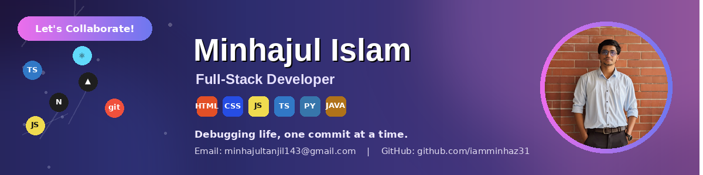

# Hi, I'm Minhajul Islam Tanjil

### Full-Stack Developer · CSE Graduate · ML Enthusiast

Building responsive web applications with React, Next.js, and TypeScript.

[Portfolio](https://minhaz-portfolio-sooty.vercel.app/) · [LinkedIn](https://www.linkedin.com/in/minhajul-islam-tanjil/) · [Email](mailto:minhajultanjil143@gmail.com)

---

## About Me

I'm **Minhajul Islam Tanjil**, a Computer Science and Engineering graduate from **Green University of Bangladesh**, based in Dhaka, Bangladesh.

I build responsive web applications using React, Next.js, JavaScript, TypeScript, and Tailwind CSS. My projects include **BazarDor**, **FitLog**, and **DevStack**, with features such as API integration, authentication, product filtering, and interactive interfaces.

My academic research focused on **audio-visual deepfake detection**. I'm interested in machine learning and cybersecurity, and continue developing my web development skills through practical projects and Programming Hero's learning track.

I'm open to **internships and junior web developer opportunities**.

---

## Technologies & Tools

**Frontend**

**Backend & Databases**

**Machine Learning & Data**

**Workflow & Deployment**

---

## Featured Projects

| Project | Description | Live Site |
|---|---|---|
| **BazarDor** | Bengali market price application with category sorting, protected product details, authentication, and profile updates. Built with Next.js, TypeScript, Tailwind CSS, Better Auth, and PostgreSQL. | [Visit BazarDor](https://bazardor-app.vercel.app/) |
| **FitLog** | Workout library with sorting, workout details, saved workouts, and a personal workout plan. | [Visit FitLog](https://fitlog-zeta-ten.vercel.app/) |
| **DevStack** | Responsive React application for exploring development technologies and building a personal technology stack. | [Visit DevStack](https://dev-stack-eight.vercel.app/) |
| **Portfolio** | Personal website showcasing my projects, skills, education, achievements, and downloadable CV. Built with HTML, CSS, and JavaScript. | [Visit Portfolio](https://minhaz-portfolio-sooty.vercel.app/) |

**Source code:** [FitLog](https://github.com/iamminhaz31/fitlog) · [DevStack](https://github.com/iamminhaz31/dev-stack) · [Portfolio](https://github.com/iamminhaz31/minhaz-portfolio)

---

## Research & Achievements

- **Audio-visual Deepfake Detection:** Academic research exploring visual and temporal features for detecting manipulated media.
- **MoneyBag — IDP Course Project:** Placed among the top three projects in an Integrated Design Project course.

---

## Current Focus

- Building accessible, responsive interfaces.
- Improving React, Next.js, and TypeScript skills.
- Working with authentication, REST APIs, and databases.
- Exploring machine learning and cybersecurity.
- Preparing for internships and junior developer roles.

---

## GitHub Analytics

---

## Connect with Me

- **Portfolio:** [minhaz-portfolio-sooty.vercel.app](https://minhaz-portfolio-sooty.vercel.app/)
- **LinkedIn:** [Minhajul Islam Tanjil](https://www.linkedin.com/in/minhajul-islam-tanjil/)
- **GitHub:** [@iamminhaz31](https://github.com/iamminhaz31)
- **Email:** [minhajultanjil143@gmail.com](mailto:minhajultanjil143@gmail.com)
- **Location:** Dhaka, Bangladesh
